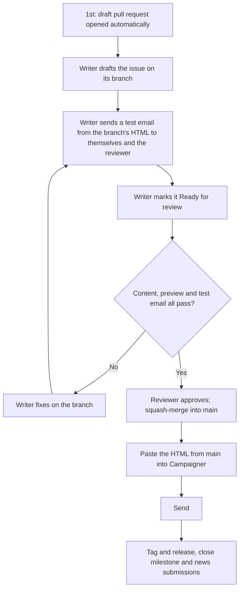
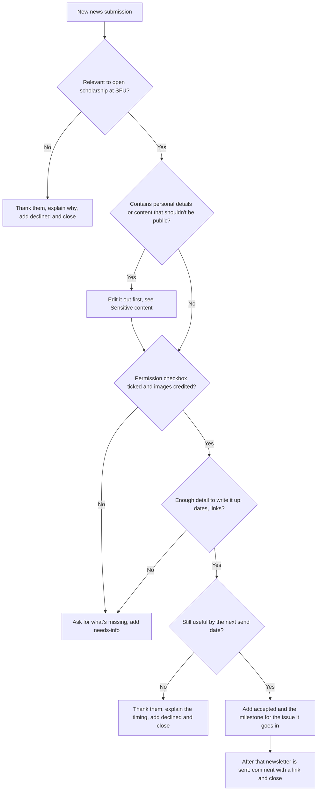
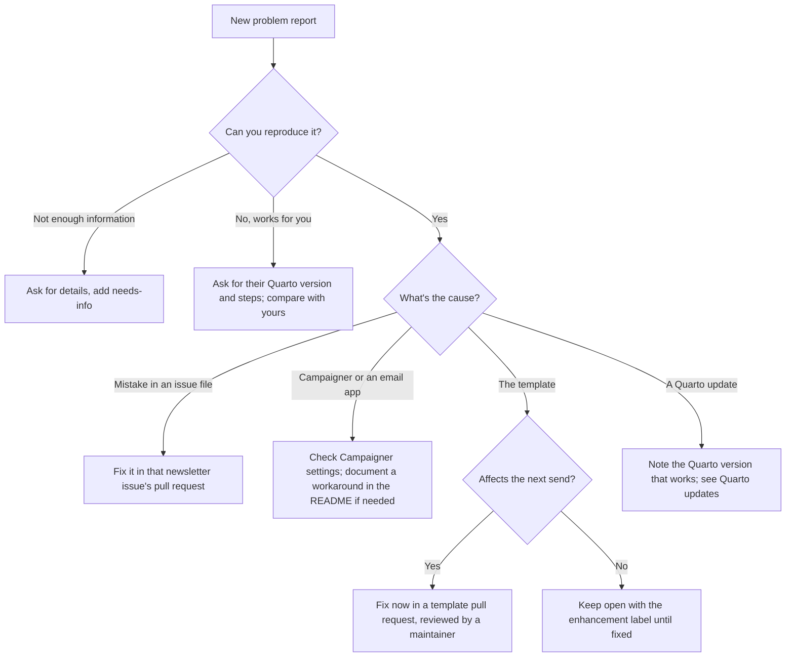
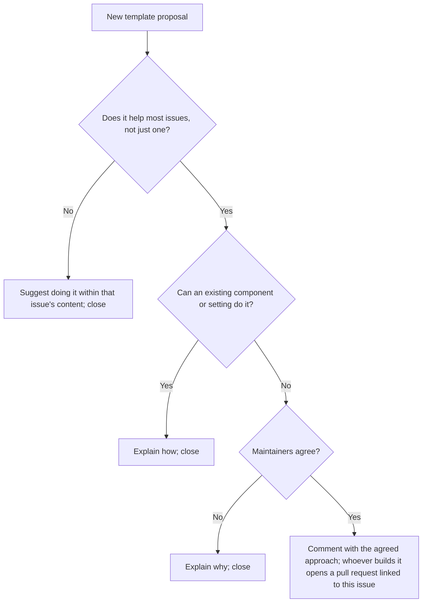
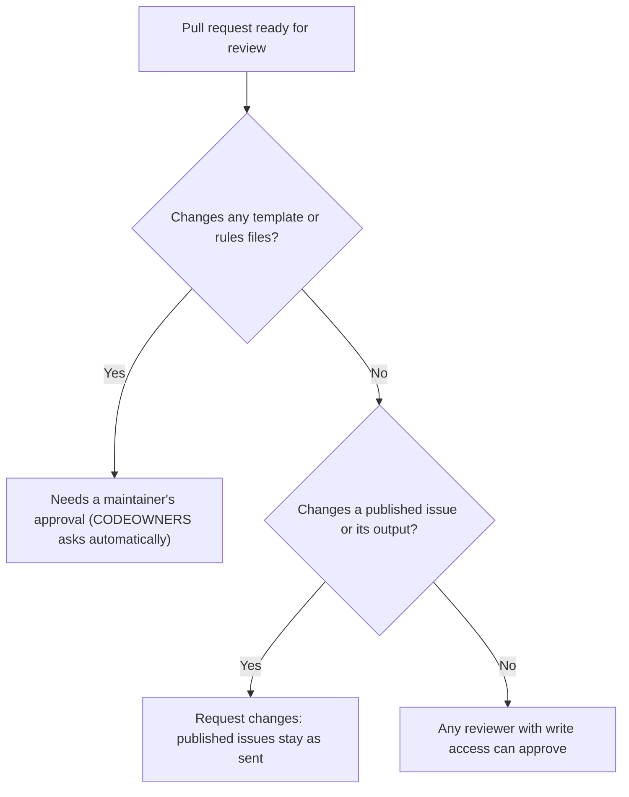

# Maintainer's guide

This guide is for the people who look after the repository: reviewing pull
requests, triaging GitHub issues, sending each newsletter and keeping a record
of what was sent. Contributors should read [CONTRIBUTING.md](CONTRIBUTING.md)
instead.

A note on words: in this repository, an **issue** can mean a newsletter
edition (a `.qmd` file) or a GitHub issue. This guide says **newsletter
issue** and **GitHub issue** to keep them apart.

## Contents

- [Maintainers](#maintainers)
- [The monthly cycle](#the-monthly-cycle)
- [Triaging GitHub issues](#triaging-github-issues)
- [Reviewing pull requests](#reviewing-pull-requests)
- [After sending: tags and releases](#after-sending-tags-and-releases)
- [Monitoring stalled issues and pull requests](#monitoring-stalled-issues-and-pull-requests)
- [Labels and milestones](#labels-and-milestones)
- [Automation](#automation)
- [Repository settings](#repository-settings)
- [Sensitive content](#sensitive-content)
- [Adding and removing maintainers](#adding-and-removing-maintainers)
- [Yearly housekeeping](#yearly-housekeeping)

## Maintainers

Maintainers are the members of the
[`maintainers` team](https://github.com/orgs/open-scholarship-sfu/teams/maintainers).
The team is listed in `.github/CODEOWNERS`, so its members must approve any
change to the template (`_quarto.yml`, `_extensions/`, `scripts/`,
`.github/`, `.devcontainer/`) and to the project's rules (`LICENSE`,
`CONTRIBUTING.md`, this file).

Maintainers:

- review and merge pull requests
- triage news submissions, problem reports and template proposals
- send each newsletter from Campaigner and record it with a tag and release
- keep the repository settings, labels and automation working

## The monthly cycle

| When | What happens | Who |
|---|---|---|
| 1st of the month | The automation creates `issues/YYYY-MM-month.qmd` on a branch and opens a draft pull request listing open news submissions | Automatic |
| Through the month | Triage news submissions into the month's milestone | Maintainers |
| Writing | The writer works on the draft pull request's branch, rendering only that file | Writer |
| Test | The writer pastes the branch's rendered HTML into Campaigner and sends a test email to themselves **and the reviewer** | Writer |
| Ready | The writer marks the pull request **Ready for review** | Writer |
| Review | The reviewer checks the content, the preview and the test email they received (see [Reviewing pull requests](#reviewing-pull-requests)) | Reviewer |
| Merge | Squash-merge the pull request into `main` | Maintainer |
| Send | Paste the HTML **from `main`** into Campaigner and send | Maintainer |
| After sending | Tag and release the issue, close the milestone and the featured news submissions | Maintainer |

**A pull request is merged only after its test email passes.** The test
uses the HTML from the branch's final commit. Squash-merging doesn't change
file contents, so that HTML is identical to what lands on `main`, and to
what is sent.

**Any change after the test means a new test.** If a commit is pushed after
the test email (even a one-word fix), the reviewer's approval is dismissed
automatically; send a new test before approving again.

**Send from `main`.** The HTML on `main` is the record of what was sent, so
paste it from there. If something must change after merging, open a new pull
request, test it, merge it, and only then send.



## Triaging GitHub issues

Check new GitHub issues at least once a week. Every new issue should get a
first response within a week, even if it's only "thanks, we'll look at this".

### News submissions (label `news`)



- **Too late for one month but fine for the next?** Move it to the next
  month's milestone and tell the submitter.
- **No reply to `needs-info`?** See
  [Monitoring stalled issues](#monitoring-stalled-issues-and-pull-requests).

### Problem reports (label `bug`)



### Template change proposals (label `enhancement`)



Prefer fewer components. Every new one is something someone must understand
and maintain later.

## Reviewing pull requests

### Who must approve



- **One approval** is required for every pull request, and approvals are
  dismissed if new commits are pushed.
- **Template changes** belong in their own pull request, never mixed with a
  newsletter issue.

### Checklist for a newsletter issue

- Front matter complete, with a preheader describing **this** issue.
- Only the issue's own `.qmd` file and its output in `_output/` changed (check
  the "Files changed" tab).
- Output matches the source: if unsure, check out the branch and run
  `quarto render` on the file; `git status` should show no changes.
- Images load in the preview and use exact Campaigner file names, with alt
  text.
- Links work, dates are right and events are in date order.
- Any changes from the source document are listed and acceptable.
- **You received the test email yourself** and checked it on desktop and
  phone, and no commits were pushed after it was sent. Don't approve on the
  writer's word alone.

### Checklist for a template change

- Linked to an agreed template proposal.
- Screenshots before and after, on desktop and phone.
- The working issue renders without errors, and you received a test email
  sent from the branch's final commit and checked it on desktop and phone.
- No published issue's output changed.
- README updated if writing issues changes.

### When to bypass the approval rule

Repository admins can merge without an approval ("bypass for pull requests
only"). Use this **only** when:

- it's a newsletter issue (not a template change), **and**
- no other reviewer is available before the planned send date.

When you bypass, leave a comment on the pull request saying why. Never
bypass for template or rules changes.

### Merging

Always use **Squash and merge**. Edit the squash commit title to say what it
is, for example `December 2026 newsletter issue (#12)`.

## After sending: tags and releases

Each sent newsletter gets a tag and a release, so there is a permanent,
easy-to-find record of exactly what went out.

- **Tag name:** `YYYY-MM`, for example `2026-12`
- **Release title:** the month and the issue's headline, for example
  `December 2026: It's the most wonderful time of the year!`

**On GitHub:**

1. Go to **Releases** → **Draft a new release**.
2. **Choose a tag**: type `2026-12` and choose **Create new tag on publish**.
   Target: `main`.
3. Add the title. In the description, give the send date and a link to the
   newsletter issue's pull request.
4. Attach `_output/issues/2026-12-december.html` (download it from `main`).
5. **Publish release**.

**From the command line** (with the [GitHub CLI](https://cli.github.com/)):

```bash
git switch main && git pull
gh release create 2026-12 _output/issues/2026-12-december.html \
  --target main \
  --title "December 2026: It's the most wonderful time of the year!" \
  --notes "Sent on December 4, 2026. Pull request: #12"
```

Then:

- close the month's milestone
- comment on each featured news submission with a link to the release, and
  close it

**If you find a mistake after sending:** don't edit the published issue or
its output. If it matters, add a correction to the next issue. If the release
needs a note, edit the release description, not the files.

## Monitoring stalled issues and pull requests

Once every two weeks, go through open GitHub issues and pull requests, sorted
by **Least recently updated** (the sort menu on each list).

| Situation | Wait | Then |
|---|---|---|
| News submission with `needs-info` and no reply | 2 weeks | Comment that you're closing it and they can reopen with the details; close |
| News submission accepted, but its month has passed | — | Move it to the next milestone if still useful; otherwise comment and close |
| Problem report with `needs-info` and no reply | 4 weeks | Comment and close |
| Template proposal with no activity | 2 months | Ask whether it's still wanted; close after 2 more weeks without a reply |
| Draft newsletter pull request past its month | — | Ask the writer: finish it, or close it and carry content into next month's pull request |
| Pull request waiting for review | 1 week | Request a review from someone specific, or review it yourself |
| Pull request with requested changes and no update | 2 weeks | Ask the author; if no reply after another 2 weeks, close it, offering to reopen |

Useful searches:

- waiting on someone: `is:open label:needs-info`
- stalled drafts: `is:pr is:open draft:true`
- waiting for review: `is:pr is:open draft:false review:required`
- untriaged news: `is:issue is:open label:news -label:accepted -label:needs-info`

When closing for inactivity, always be friendly and say how to reopen.

## Labels and milestones

| Label | Meaning |
|---|---|
| `news` | News submission (added by the form) |
| `bug` | Problem report (added by the form) |
| `enhancement` | Template change proposal (added by the form) |
| `needs-info` | Waiting for the person who opened it |
| `accepted` | News submission accepted for a newsletter issue |
| `declined` | Not taken forward |

Create one **milestone per month**, named like `December 2026`, with the
planned send date as its due date. Accepted news goes into it. Close it after
sending.

## Automation

`.github/workflows/new-issue.yml` runs at 15:00 UTC on the 1st of each month
(7 a.m. PST, 8 a.m. PDT). It runs `scripts/new-issue.ts` to create the month's
issue file from `issues/_starter.qmd`, pushes it to a branch such as
`issue/2027-01-january`, and opens a draft pull request listing open news
submissions. If the file or branch already exists, it does nothing.

- **Run it by hand** (for example, to start next month early): **Actions** →
  **Start the monthly newsletter issue** → **Run workflow**, optionally with
  a month like `2027-01`.
- **Check it ran**: on the 1st, look for the new draft pull request. If it's
  missing, open the workflow's latest run in **Actions** to see the error.
- **Required setting**: Settings → Actions → General → Workflow permissions
  → **Allow GitHub Actions to create and approve pull requests**.
- **Scheduled runs pause** in public repositories after 60 days without
  activity. If GitHub disables the workflow, re-enable it from the
  **Actions** tab.
- **The issue number** is one more than the highest `issue:` in existing
  issue files, so keep issue numbers correct in every file.

The same script works locally: `quarto run scripts/new-issue.ts 2027-01`.

## Repository settings

These are set in **Settings** and should be checked once a year:

- **Rules → Rulesets → Protect main**: targets the default branch; requires a
  pull request with one approval, dismissal of stale approvals, Code Owner
  review and resolved conversations; squash merges only; blocks force pushes
  and deletion. Bypass: repository admins, for pull requests only.
- **General**: squash merging only; automatically delete head branches.
- **Code security**: secret scanning and push protection on.
- **Actions → General**: GitHub Actions may create pull requests.
- **Issues**: issue forms and `config.yml` in `.github/ISSUE_TEMPLATE/`;
  blank issues off.

### Quarto updates

Any Quarto version from 1.4 works. When a maintainer updates Quarto, they
render the latest newsletter issue to a scratch copy and compare it with the
committed output. If the output changes, note the last version that worked in
the README and open a problem report.

## Sensitive content

The repository is public, including every GitHub issue and comment.

- **Personal details or private information in a GitHub issue:** edit the
  issue or comment to remove it (the **…** menu → **Edit**). Note that GitHub
  keeps an edit history visible to others; for anything serious, ask a
  repository admin to delete the issue and ask the submitter to resubmit
  without it.
- **Spam or abuse:** hide the comment (**…** → **Hide**), lock the
  conversation if needed, and block the user from the organization settings.
- **Passwords, keys or Campaigner credentials committed by mistake:** change
  the password or revoke the key immediately (removing it from the history
  isn't enough), then remove it from the repository.
- **Images without permission:** remove them from the newsletter issue
  before sending, and from the repository if they were committed.

## Adding and removing maintainers

**Adding:**

1. Add the person to the `maintainers` team in the organization.
2. Check they have two-factor authentication on (required by the
   organization).
3. Point them to this guide and CONTRIBUTING.md.

**Removing:** remove them from the team, check the ruleset's bypass list and
any CODEOWNERS entries naming them, and reassign their open pull requests and
GitHub issues.

The team needs **write** access to the repository for CODEOWNERS to work.

## Yearly housekeeping

- Review team membership, the ruleset and the settings above.
- Review labels and close old milestones.
- Check the actions used in `.github/workflows/` for newer major versions.
- Re-read CONTRIBUTING.md, the README and this guide, and update anything
  that no longer matches how you work.
